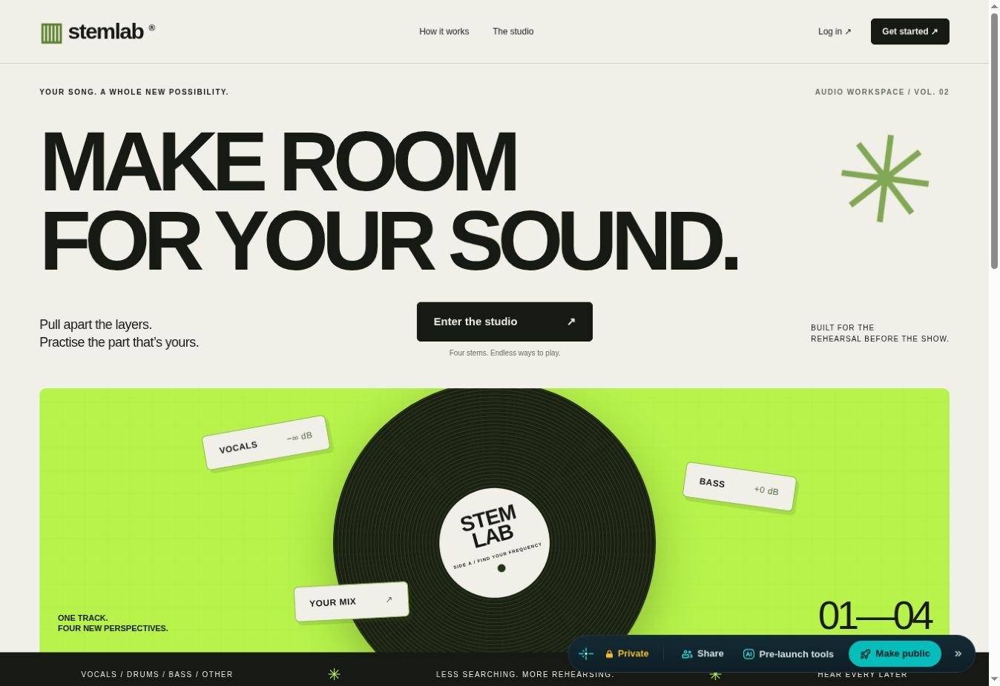
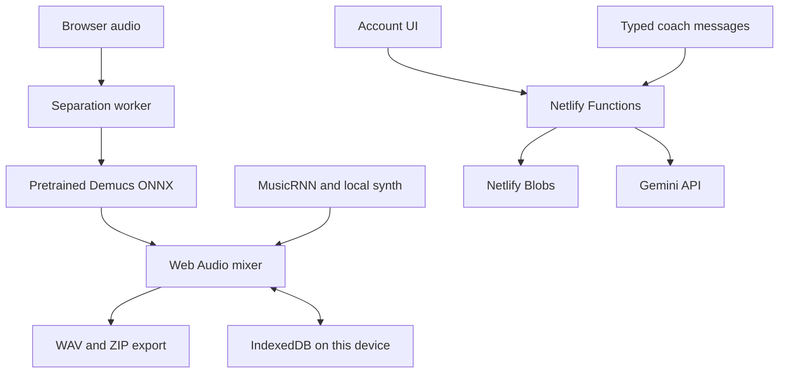

# StemLab
### Turn a song into a rehearsal workspace

StemLab is a browser music studio for learners and musicians who want to isolate a part, practise a section and export a backing mix. It integrates **pretrained Demucs** for four-source separation with a shared-clock Web Audio mixer, effects and downloads.

[Open the deployed site](https://stemlab-krishmannadal.netlify.app/) · [Local Python edition](LOCAL_SETUP.md) · [Recorded validation history](VALIDATION.md)


*Public landing page captured during the 23 October 2026 audit. This image shows the interface, not a separation result.*

**Status:** application prototype; desktop browser inference. This project integrates existing models—it does not train a new separation, composition or voice model.

## What you can inspect

| Capability | Implemented in current source | Verification boundary |
| --- | --- | --- |
| Email/password accounts | Netlify Functions + Blobs; cookie sessions | Landing and account gate observed live; authentication not tested in this audit |
| Four stems | Demucs ONNX worker: vocals, drums, bass, other | Source/build checked; historical browser smoke tests in VALIDATION.md; not rerun on production |
| Rehearsal mixer | Shared playback clock, gain, mute/solo, presets, A–B loops | Export arithmetic tested locally; production account session not exercised |
| Downloads & additions | Stem WAVs, raw-source ZIP, remix/section WAV; up to three added tracks | Local automated tests cover gains, crops and added-track offsets |
| Per-track effects | EQ, compression, reverb, pan; pitch and independent formants | Settings/parser tests pass; perceptual voice quality not established |
| Instrument composer | Pretrained Magenta MusicRNN plus local synthesis | Source and packaged weights checked; current production generation not exercised |
| Tune coach | Gemini text suggestions with validated controls and Apply | Provider calls mocked in local tests; current key/quota not verified |

**Audit verification, 23 October 2026:** `npm ci`, `npm run build` and **18/18 Node tests** passed in a clean clone. The live landing page loaded and “Explore a synthetic demo” opened account creation. No account was created or authenticated, so this audit does not certify end-to-end production studio behavior. [VALIDATION.md](VALIDATION.md) contains earlier developer checks; those are recorded evidence, separate from this refresh.

## Try it

1. Open the site in desktop Chrome or Edge. Sign in/create an account.
2. Start with **Explore a synthetic demo** to inspect the mixer. Its known generated sources are **not** a neural separation result.
3. For actual separation, choose a music clip **up to 30 seconds / 10 MB**. The first use downloads about **166 MiB** of model data.
4. Solo a source, choose a practice preset, or set a loop. Download a stem or your mix.
5. Optional: tune a track, add audio, or use Generate part. Preview before adding generated audio to the remix.

Mobile/tablet and low-memory devices are blocked from neural separation to reduce renderer crashes. The account UI and synthetic mixer are designed for mobile use; real-device performance was not checked in this audit.

## Architecture



Audio processing stays on the device in the web edition. Typed chat/history goes to Gemini through the server. Accounts persist online; audio sessions remain in IndexedDB on the current browser/device and do not sync between devices.

**Verified stack:** JavaScript ES modules, ONNX Runtime Web, `demucs`, Web Audio, `@magenta/music`, Signalsmith Stretch WASM, `fflate`, esbuild, Netlify Functions and Blobs. See [package.json](package.json) and [web/src/](web/src/).

## Build and run locally

Node **22** is the deployment configuration in [netlify.toml](netlify.toml).

```bash
git clone https://github.com/krishmannadal/StemLab.git
cd StemLab
npm ci
npm test
npm run build
npx netlify dev
```

Use the URL printed by Netlify CLI (normally `http://localhost:8888`). Full account testing needs a linked/configured Netlify project and its Blobs context; that integration was not exercised here. Opening `dist/index.html` directly does not provide Functions or cross-origin isolation headers.

The build creates `dist`, copies same-origin runtime assets, splits Demucs weights into 21 parts, and packages pinned MusicRNN assets. `.npmrc` disables dependency lifecycle scripts because the unused native Node inference runtime is unnecessary for the browser build.

<details>
<summary>Deploy, environment variables and model downloads</summary>

Import the repository into Netlify using the root configuration: build `npm run build`, publish `dist`, Functions `netlify/functions`, Node 22. COOP/COEP headers are defined there for inference assets. Hosting/model bandwidth and Functions remain subject to provider plan limits.

| Variable | Used for | Required? |
| --- | --- | --- |
| `GEMINI_API_KEY` | Server-side Gemini coach access | Only for Gemini chat |
| `GEMINI_MODEL` | Optional compatible model override | No; source discovers an available Flash model |
| `steamlab` | Legacy server-side key alias | Only for existing compatibility; prefer canonical variable |

Set server variables with Functions scope and redeploy. Never commit values. Blobs credentials are supplied by Netlify. No Gemini key is needed for Demucs, DSP effects, local presets or MusicRNN generation.

The first neural separation download is about 166 MiB. The composer lazily loads its worker and approximately 12 MB of weights per selected model family. Build-time model hashes are pinned in [web/composer-models.json](web/composer-models.json).

</details>

<details>
<summary>Tuning, generation and voice-transform scope</summary>

- Local prompt suggestions match built-in keywords/presets. They are labelled separately from Gemini replies.
- Gemini is a text assistant that can propose validated settings for a selected track; Apply tuning renders locally. Connection success does not guarantee generation quota.
- Tempo estimation uses drum onsets/autocorrelation and an editable grid assuming 4/4. It does not recognize harmony, song key, downbeats or variable-tempo structure reliably.
- Drums use pretrained `drum_kit_rnn`; flute, bass and keys use `basic_rnn` phrases rendered by local synthesis. These are not realistic recorded instruments or full-song text-to-music generation.
- Pitch/formant presets use Signalsmith DSP. A “female”/“male” request selects an approximate treatment; it does not guarantee perceived gender, clone a singer or perform automatic pitch correction. Pitch shifting changes the key against unshifted backing tracks.
- Saving a session preserves settings; resetting restores original audio. The source-stem ZIP remains unprocessed.

</details>

## Limitations and next work

Separation can leak sources and introduce artifacts; no SDR benchmark or listening study is reported. Loops can have a small restart gap. Browser memory limits input duration. Email verification/password recovery are absent; signup does not prove email ownership. Clearing site storage removes local audio.

Next: record a reproducible signed-in production smoke test, evaluate short licensed excerpts, improve recovery/export feedback, and test memory behavior on representative desktop devices.

## Credits and licensing

Repository history records development by Krishnakumar Mandal. The original Python/FastAPI edition remains in `app.py`, `worker.py` and `run.py`; Netlify deploys the separate `web/` edition.

- [Meta Demucs](https://github.com/facebookresearch/demucs) and [demucs-js](https://github.com/bakkot/demucs-js): pretrained separation/model conversion and browser inference.
- [Magenta.js](https://github.com/magenta/magenta-js): pretrained MusicRNN, Apache-2.0 code; bundled [composer notice](web/composer-license.txt).
- [Signalsmith Stretch](https://github.com/Signalsmith-Audio/signalsmith-stretch): pitch/formant DSP; bundled [voice notice](web/voice-license.txt).

The existing [LICENSE](LICENSE) separates application code from third-party model/data terms. The Demucs package's weights notice restricts use to personal/research scope; this README does not relicense those weights. Design/product references: [Godly](https://godly.design/websites/), [stems](https://github.com/ummerr/stems) and [client-side-ml](https://github.com/mcfredrick/client-side-ml).


## Leave Me Space (experimental)
Open **Generate / Leave Me Space**, enable responses, choose the lead track, detect and review its active intervals, then generate flute, bass or keys responses. Density and breathing-room controls keep complete phrases out of the lead regions. Preview fixed/predicted intensity responses or the two comparison baselines, download the comparison WAVs/JSON, and add the preferred result to your remix. Generated audio and planning metadata persist with the session.

A new small bidirectional GRU is bundled locally. It was trained on synthetic activity examples, not real musical preferences. See [the research protocol, training instructions and limitations](research/leave-me-space/README.md). Existing MusicRNN still supplies the notes; this model plans placement. This is a prototype for evaluation, not an established novel research result.
